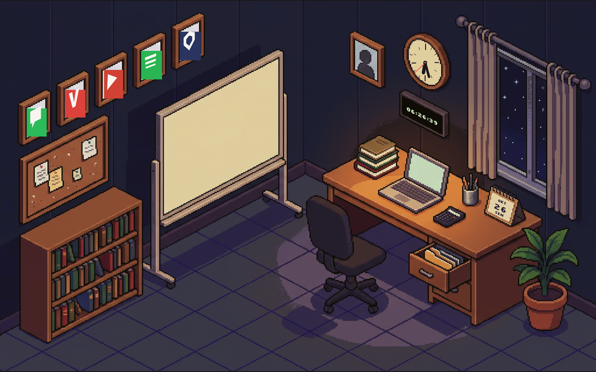

# Ruang Kelas — launcher workspace gaya soft-pastel

Launcher Android (Kotlin + Jetpack Compose) untuk **HUAWEI MatePad Mini 8,8"**:
satu layar berisi gambar workspace isometrik ukuran penuh. Tanpa sidebar, tanpa tab,
tanpa header, tanpa panel. Setiap objek di gambar bisa diketuk untuk membuka aplikasi
bawaannya — aplikasi itu dibuat menyusul, satu per satu.

**Status: v0.16.0 — TAMPILAN DIBANGUN ULANG DARI AWAL. Ruang kerja klasik
yang sama (lampu meja anglepoise, papan tulis beroda, papan pin, rak buku,
jendela yang membuka keluar, gorden kiri–kanan, tanaman, tempat sampah) digambar
baru di kanvas 1280×800. Mode siang kini
gambar tersendiri: lampu padam, matahari & awan di jendela; malam: lampu
menyala dengan genangan cahaya hangat. Konsep launcher tetap: ketuk objek →
buka aplikasi (11 zona), bingkai dinding kosong sebagai hiasan, jendela
terbuka keluar saat siang dan tertutup rapat saat malam (tirai menutup,
tirai diam — hanya daun tanaman yang bergoyang), ketuk langit jendela kanan membuka aplikasi Cuaca, suasana
siang/malam mengikuti jam perangkat.**


Perbaikan 0.15.12: membalik arah 0.15.11 — bukan lagi ruangan kosong tanpa
lampu, melainkan suasana kerja malam klasik seperti gambar yang dijadikan
acuan: sudut meja, buku, dan laptop kembali persis seperti versi 0.15.7 yang
bersih. Dan sebelumnya, 0.15.11: standing lamp di sudut atas ruangan
(di antara meja dan papan tulis). Sebelumnya lagi, 0.15.9: 0.15.8 ternyata merusak sudut ruangan dan memotong meja,
buku, serta laptop (garis tepi belakang meja terbalik arah) — semuanya
dikembalikan dari art 0.15.7, lalu hanya fixture lampu mejanya yang dihapus.
Standing lamp digambar ulang mengikuti referensi lampu kerja lantai dan
diletakkan di sebelah papan tulis; cahaya malamnya (globe hangat, halo dinding,
kolam lantai) diarahkan sama seperti lampu meja dahulu. Dan sebelumnya,
0.15.7: kalender meja (kertas tent + spiral) dihapus dari gambar dan
hotspot-nya pun demikian — layar Kalender masih ada, menunggu pintu baru. Dan
sebelumnya, 0.15.6: jam digital dinding (jam:menit, tanggal, bilah detik) dan
sisa benderanya dihapus dari launcher — dinding kini bersih, dan mengetuk papan
tulis "Jadwal Mengajar" yang membuka aplikasi Jadwal. Sebelumnya lagi, rel 0.15.4:
saat siang kecerahan ruangan datang dari jendela (gradasi dingin kebiruan,
pantulan cahaya jendela di lantai, bayangan jatuh ke kanan-bawah) — kini kecerahan
meja bergeser ke kiri (arah standing lamp). Dan sebelumnya, sisi kanan gorden:
kain 36 px (dari 58 px) dan rel mulai tepat di ujung jendela sehingga dinding kiri
tidak lagi tertutup; garis rel dan angka persentase dibuat lebih tipis/kecil.

| | |
|---|---|
| Langit hidup | Matahari/bulan bergerak, warna langit waktu nyata, awan/hujan/salju/kabut/kilat mengikuti cuaca (Open-Meteo) |
| APK siap pasang | [`dist/RuangKelas-0.16.19-debug.apk`](dist/RuangKelas-0.16.19-debug.apk) |
| Build otomatis | [`.github/workflows/android.yml`](.github/workflows/android.yml) |
| Bukti jalan | [`docs/index.html`](docs/index.html) · [`docs/screens/`](docs/screens) |
| Prototipe HTML lama | diarsipkan — lihat [`arsip/0.15.12/`](arsip/0.15.12) (ambil dari sejarah git) |



## Cara memasang

1. Unduh `dist/RuangKelas-0.16.19-debug.apk`, buka di tablet, izinkan "instal dari sumber ini".
2. Buka **Ruang Kelas** — launcher langsung tampil penuh, landscape, tanpa system bar.

## Mode landscape

- Layar dikunci **landscape** di manifest (`sensorLandscape`) dan ditegaskan lagi di
  `MainActivity.requestedOrientation`, jadi tidak bisa berputar ke portrait.
- Gambar selalu mempertahankan rasio aslinya **16:10**. Kalau layar lebih lebar/pendek,
  sisa ruang dibiarkan hitam (letterbox) — art tidak pernah melar dan koordinat ketuk
  tetap presisi. Semua posisi dihitung dari satu satuan `unit` (ukuran 1 piksel gambar),
  dipakai bersama oleh gambar dan 17 area ketuk.
- Di browser, jendela portrait menampilkan ajakan "putar ke landscape"; kalau didukung,
  browser juga diminta mengunci orientasi saat layar disentuh.

## Objek yang bisa diketuk

Koordinat ketuk disimpan di `Data.kt` (`TILES`, satuan piksel gambar 1312 × 816):

| Objek | Aplikasi |
|---|---|
| Laptop | Jurnal |
| Tumpukan buku di meja | Nilai |
| Kalkulator (kanan laptop) | Kalkulator |
| Tempat pensil | Alat Tulis |
| Laci meja, rak buku | Binder Materi |
| Papan tulis | Absensi |
| Papan pin (atas rak) | Buku Catatan |
| Papan tulis "Jadwal Mengajar" | Jadwal |
| Foto user di dinding | Profil & pengaturan launcher |
| Jendela | Cuaca (aplikasi asli: Open-Meteo, cadangan offline, 9 kota) |
| Tempat sampah (sudut kiri bawah) | File manager: aplikasi berkas bawaan, atau pemilih dokumen Android |
| Bingkai-bingkai dinding | Hiasan kosong |

Judul papan tulis bukan gambar mati: `Launcher.kt` menggambarnya di atas
scene mengikuti bidang miring papan.

- **Papan tulis** (`BOARD_QUAD`) diberi judul **"Jadwal Mengajar"** rata tengah di bagian
  atas, dengan garis tipis di bawahnya. Mengetuknya membuka `Jadwal`; ke depan di sinilah
  alarm, pengatur waktu, dan jam dunia akan ditampung.
- **Ikon lima bingkai** digambar mengikuti vektor bingkai (`FRAME_QUADS`), jadi ikon
  ikut miring seperti kertasnya, bukan kotak datar.

**Jendela & angin.** Kaca jendela di cat ulang jadi langit siang oleh
`tools/scene_face.py`; gorden dan daun tanaman digambar ulang dengan geseran sinus
(`WindSway`) sehingga ruangan terasa bergerak: gorden berayun pelan, daun sedikit lebih
cepat.

**Jendela & gorden.** Jendela membuka keluar (daun kaca berayun ke arah langit).
Gorden kiri dan kanan bergantung pada rel logam dan bergoyang pelan mengikuti angin;
rel kini batang polos tanpa indikator apa pun. Lihat

**Siang & malam.** `scene_face.load_scene("day"|"night")` menghasilkan dua gambar:
malam (grade navy pekat) dan siang (eksposur naik + pendar hangat di jendela + pantulan
matahari di lantai + langit siang di kaca). Launcher memilih pukul 06–17 = siang,
selebihnya malam, lalu menambahkan selaput `Ambience()` tipis sesuai jam: pagi hangat,
siang terang, sore jingga, malam biru, larut lebih gelap.

Semua tulisan digambar **menempel pada bidangnya** (miring mengikuti muka benda) dengan
`Matrix.setPolyToPoly`, bukan teks datar.

## Preview di browser

Launcher yang sama juga bisa dicoba di browser (tanpa memasang APK):

```bash
npm start          # http://localhost:4173  → menyajikan web/
npm run preview:build   # bangun ulang web/ dari art + TILES
```

`web/index.html` dibuat oleh `tools/make_preview.py` yang membaca `TILES`,
`BOARD_QUAD`, `RAIL_LINE`, `CURTAIN_RECTS`, `LEAF_RECT`, dan `SCENE_W/H`
langsung dari `Data.kt` — jadi area ketuk di browser identik dengan di APK. Gambar
penuh layar, tanpa sidebar/tab/header, objek menyala saat ditekan,
gorden kiri–kanan bergoyang, dan suasana siang/malam otomatis mengikuti
jam browser.

Cek cepat tanpa browser: `node tools/check_preview.mjs` (jsdom) memastikan
setiap hotspot berada tepat di atas objeknya.

## Struktur

```
art/workspace-iso-v7c.png         gambar isometrik terkini 1312 × 816 (gorden kiri ringkas, 0.15.5)
art/workspace-iso-v6.png          gambar sebelumnya (arsip)
art/workspace-iso-v5.png          gambar sebelumnya (arsip)
art/workspace-iso-v4.png          percobaan sebelumnya (arsip)
art/workspace-iso-v3.png          gambar sebelumnya (arsip)
art/workspace-iso-v2.png          gambar pertama (arsip)
tools/scene_face.py                grade warna, suasana siang/malam (langit + cahaya jendela)
tools/make_scene.py                → res/drawable-nodpi/scene_night.png + scene_day.png
tools/sim_overlay.py               simulasi overlay dengan PIL (cek tata letak tanpa emulator)
tools/make_preview.py              bangun web/index.html dari Data.kt (preview browser)
tools/check_preview.mjs            uji area ketuk preview (jsdom)
web/                               preview statis: index.html + scene_night.png + scene_day.png
android/app/src/main/java/dev/retrobit/ruangkelas/
├── App.kt                         MainActivity (fullscreen) + Root
├── Launcher.kt                    gambar penuh layar + 11 area ketuk + angin
├── Data.kt                        model, data contoh, simpan/muat JSON, TILES
├── Theme.kt                       token warna + font pixel
└── Ui.kt                          komponen dasar untuk aplikasi yang akan datang
```

## Build

```bash
cd android && gradle :app:assembleDebug
```

GitHub Actions menjalankan hal yang sama, menyimpan APK ke `dist/`, dan memperbarui
release `v0.16.19-android`. Workflow kedua (`android-preview.yml`, dipicu
`.ci/preview.trigger`) memasang APK di emulator tablet 2560 × 1600, memotret launcher,
mengetuk beberapa objek, lalu menyimpan screenshot ke `docs/screens/`.
